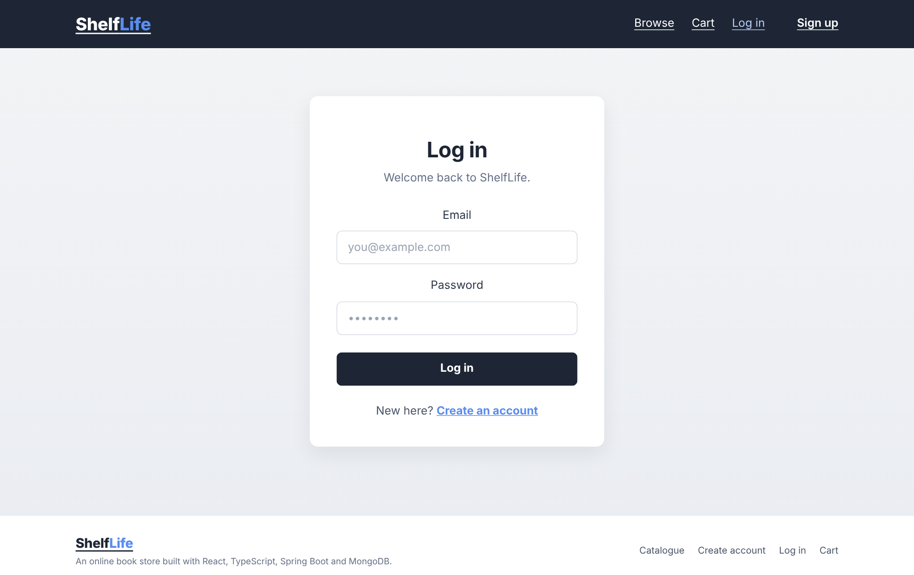
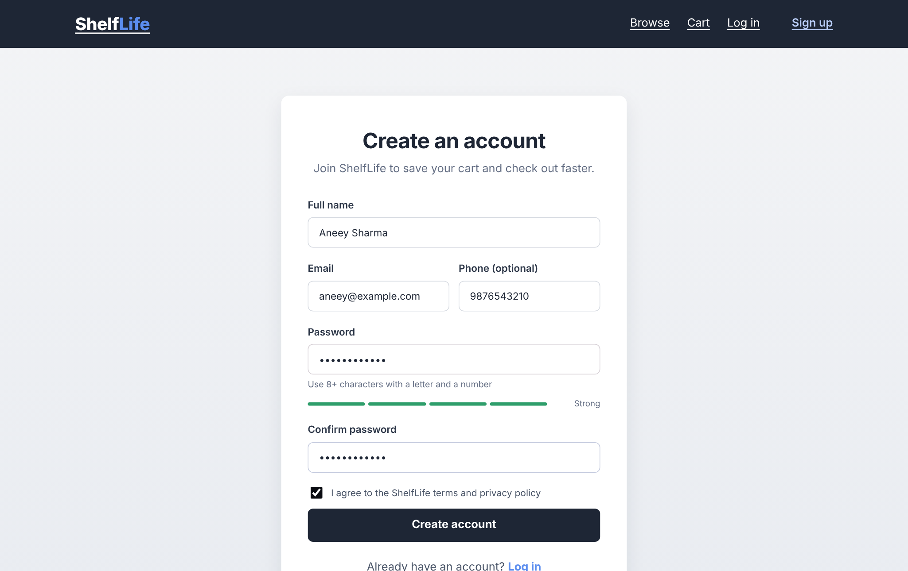
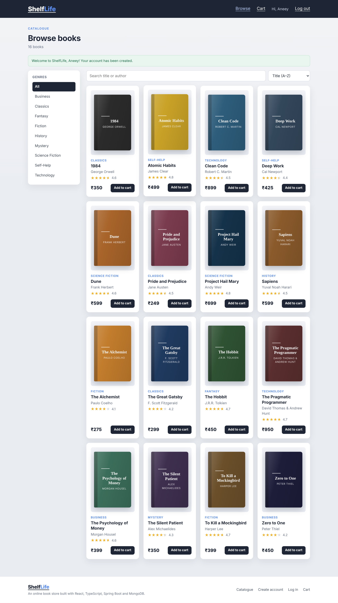
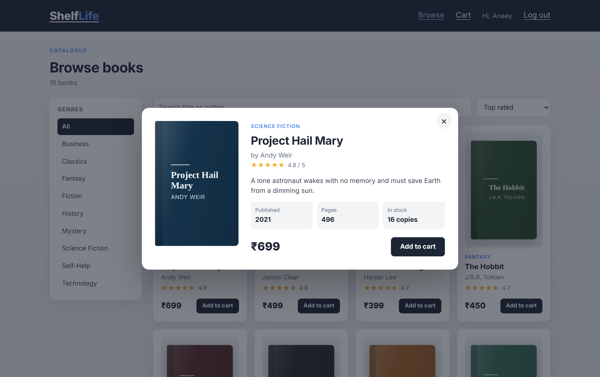
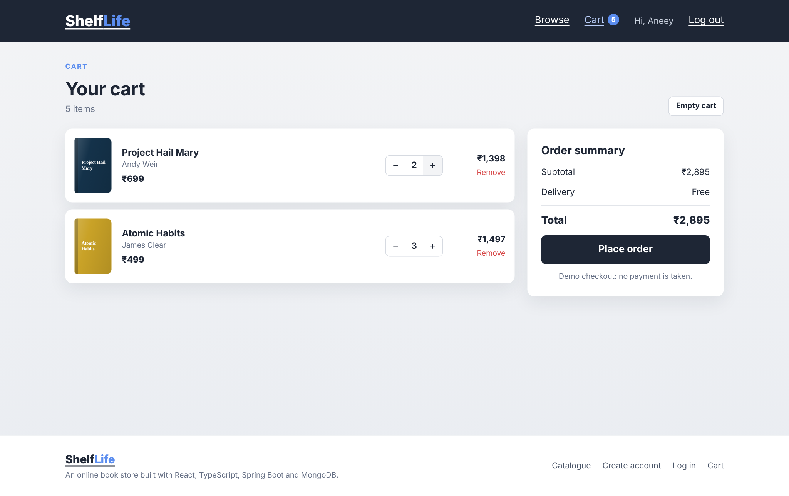
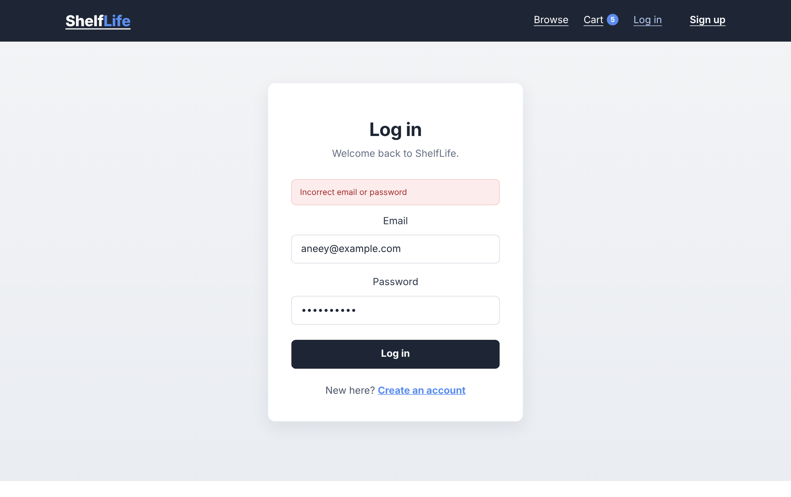
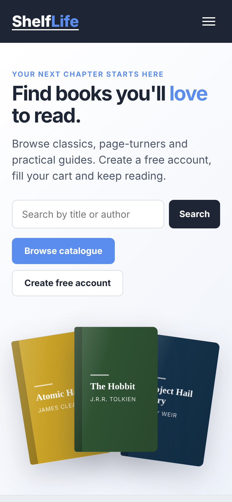
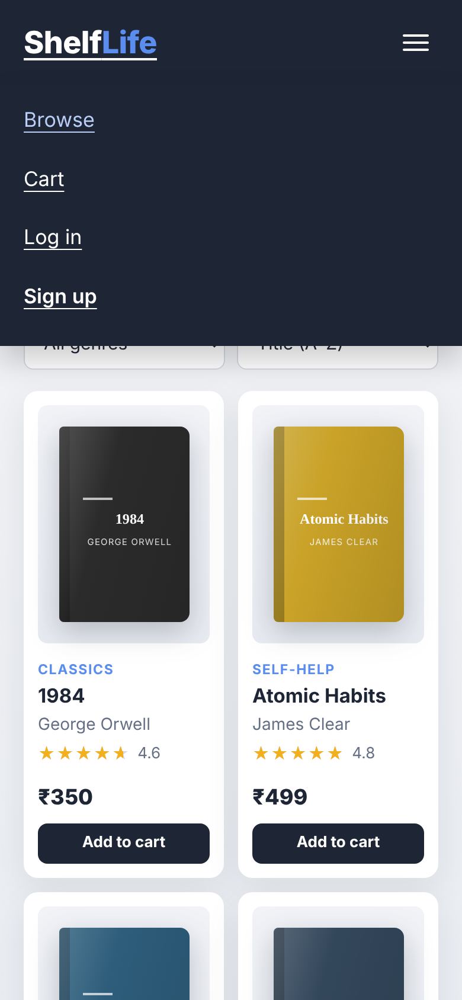

# 📚 ShelfLife: Online Book Store

A responsive, full-stack **online book store** built with **React + TypeScript** (frontend), **Spring Boot** (REST API backend) and **MongoDB** (database).

It has the four required pages, **Home**, **Login**, **Catalogue** and **Registration**, plus a shopping **Cart**. Registered users are stored in MongoDB with BCrypt-hashed passwords.


## Problem Statement

> Design and develop a responsive website for an online book store using TypeScript in React, Spring Boot and MongoDB, having:
> 1. Home Page 2. Login Page 3. Catalogue Page 4. Registration Page (database)

## ✨ Features

| Page | What it does |
|---|---|
| **Home** | Hero with search, shop-by-genre chips, featured books and highlights |
| **Login** | Email and password sign-in against the backend, clear error messages, session kept after reload |
| **Registration** | Full name, email, optional phone, password and confirm password; live validation, password-strength meter; saves the user in **MongoDB** |
| **Catalogue** | Search by title or author, filter by genre, sort (title, price, rating, newest), book-details popup, add to cart |
| **Cart** | Change quantities, remove items, subtotal and delivery, total, checkout for logged-in users (demo, no payment) |

**Also included**
- Fully **responsive**, with a hamburger menu on phones
- **Validation on both sides**: the React form and Spring Boot (`jakarta.validation`) both check input, and server field errors are shown next to the fields
- **Secure passwords**: hashed with **BCrypt** and never returned by the API
- **Token sessions**: random 256-bit tokens that expire after 24 hours, sent as `Authorization: Bearer <token>`
- **Seed data**: 16 books are loaded into MongoDB automatically the first time the backend starts
- Generated book covers (no image files needed)
- Friendly message if the backend isn't running

## 🛠️ Tech Stack

| Layer | Technology |
|---|---|
| Frontend | React 18, **TypeScript**, React Router, Vite, CSS3 |
| Backend | **Spring Boot 3** (Java 17), Spring Web, Spring Data MongoDB, Bean Validation, BCrypt |
| Database | **MongoDB** |

## 📁 Project Structure

```
Book-Store/
├── backend/                         # Spring Boot REST API
│   ├── pom.xml
│   └── src/main/
│       ├── java/com/shelflife/bookstore/
│       │   ├── BookstoreApplication.java
│       │   ├── config/        # CORS, data seeder
│       │   ├── controller/    # AuthController, BookController
│       │   ├── dto/           # Request/response records
│       │   ├── exception/     # Global JSON error handler
│       │   ├── model/         # User, Book (MongoDB documents)
│       │   ├── repository/    # Spring Data repositories
│       │   └── service/       # AuthService, BookService
│       └── resources/
│           ├── application.properties
│           └── books.json     # Starter catalogue
├── frontend/                        # React + TypeScript app
│   ├── package.json
│   └── src/
│       ├── pages/             # Home, Login, Register, Catalogue, Cart, NotFound
│       ├── components/        # Navbar, Footer, BookCard, BookCover, BookModal, Stars
│       ├── context/           # AuthContext, CartContext
│       ├── api.ts             # Typed API client
│       └── types.ts           # Shared TypeScript types
└── screenshots/
```

## 🚀 Getting Started

### Requirements
- **Java 17+** and **Maven** (or an IDE such as IntelliJ / Eclipse / VS Code)
- **Node.js 18+**
- **MongoDB** running locally on `mongodb://localhost:27017` (or a MongoDB Atlas connection string)

### 1. Start MongoDB
Install MongoDB Community Server and start it, or run it with Docker:
```bash
docker run -d -p 27017:27017 --name mongo mongo:7
```

### 2. Run the backend
```bash
cd backend
mvn spring-boot:run
```
The API starts on **http://localhost:8080** and seeds the `shelflife` database with books.
To use MongoDB Atlas instead, set `MONGODB_URI` before starting:
```bash
export MONGODB_URI="mongodb+srv://<user>:<password>@<cluster>/shelflife"
```

### 3. Run the frontend
```bash
cd frontend
npm install
npm run dev
```
Open **http://localhost:5173**. To point at a different backend, copy `.env.example` to `.env` and change `VITE_API_URL`.

## 🔌 REST API

| Method | Endpoint | Description |
|---|---|---|
| `POST` | `/api/auth/register` | Create an account → `{ token, user }` |
| `POST` | `/api/auth/login` | Log in → `{ token, user }` |
| `GET` | `/api/auth/me` | Current user (needs token) |
| `POST` | `/api/auth/logout` | End the session |
| `GET` | `/api/books?q=&genre=&sort=` | Search / filter / sort books |
| `GET` | `/api/books/featured` | Featured books |
| `GET` | `/api/books/genres` | List of genres |
| `GET` | `/api/books/{id}` | One book |
| `POST` / `PUT` / `DELETE` | `/api/books`, `/api/books/{id}` | Create / update / delete a book (needs token) |

`sort` can be `title`, `price-asc`, `price-desc`, `rating` or `newest`.

Errors return JSON such as:
```json
{ "status": 400, "message": "Please correct the highlighted fields",
  "fieldErrors": { "email": "Enter a valid email address" } }
```

## 🗄️ Database (MongoDB)

**`users` collection**
```json
{ "_id": "...", "fullName": "Aneey Sharma", "email": "aneey@example.com", "phone": "9876543210",
  "passwordHash": "$2a$10$...", "authToken": "...", "tokenExpiresAt": "...", "createdAt": "..." }
```
`email` has a unique index, so the same email can't be registered twice.

**`books` collection**
```json
{ "_id": "...", "title": "Atomic Habits", "author": "James Clear", "genre": "Self-Help",
  "price": 499, "rating": 4.8, "pages": 320, "year": 2018, "stock": 12, "featured": true }
```

## 📸 Screenshots

| Login | Registration |
|---|---|
|  |  |
| **Catalogue** | **Book details** |
|  |  |
| **Cart** | **Login error** |
|  |  |

<p align="center">
  
  
</p>

## 🔮 Future Scope

- Save orders in MongoDB with an order history page
- Admin dashboard for managing books and stock
- Online payments
- Book reviews and wishlists
- JWT with Spring Security and role-based access
